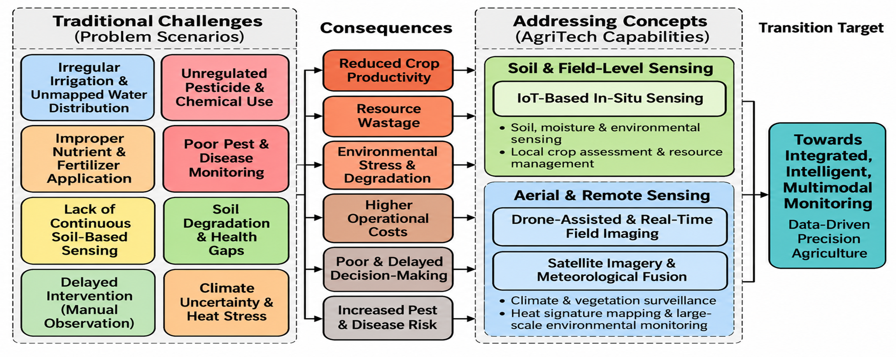
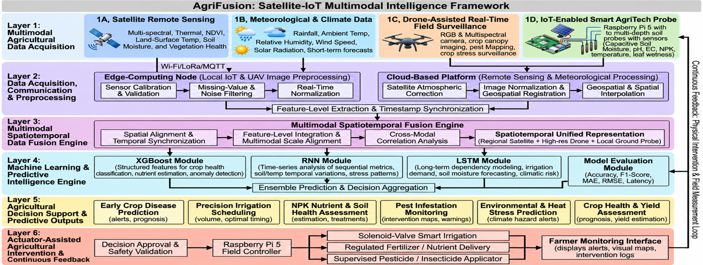
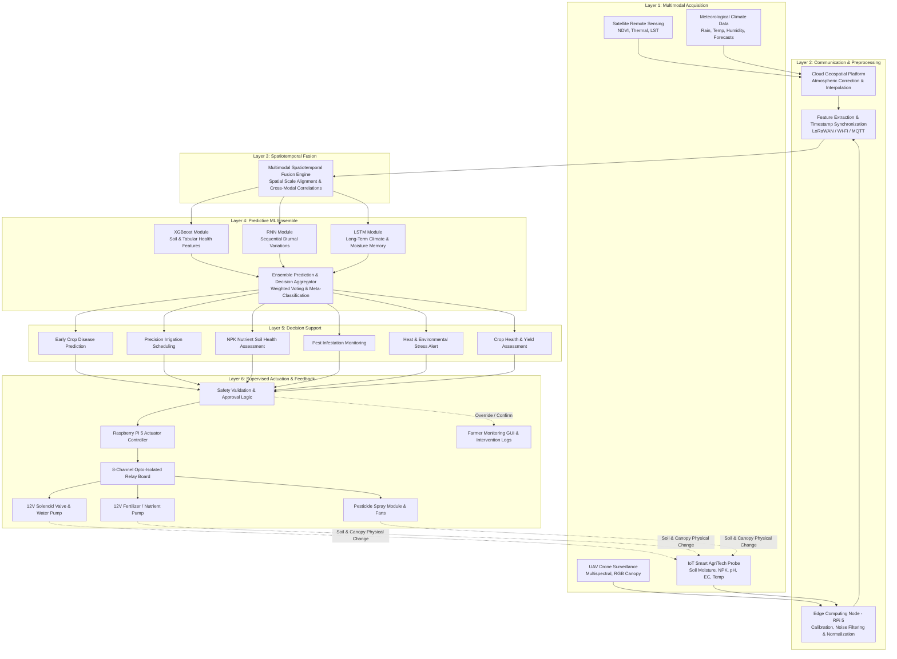

# AgriFusion

### Satellite-Assisted Multimodal Agricultural Intelligence Framework for Early Crop Disease Prediction

<p align="center">
  
  
  
  
  
  
</p>

---

## Abstract & Executive Summary

**AgriFusion** is an advanced, end-to-end precision agriculture intelligence framework designed to overcome the critical limitations of single-source agricultural monitoring. Modern farming environments face escalating challenges including irregular irrigation distribution, delayed pest/disease intervention, unregulated agrochemical application, and climate-induced stress. While satellite imagery provides broad regional overviews and ground IoT sensors offer localized real-time data, existing solutions remain fragmented, uncoordinated, and reactive.

AgriFusion establishes a unified **six-layer architectural hierarchy** that seamlessly synthesizes **satellite remote sensing (multispectral, thermal, NDVI, LST)**, **meteorological climate forecasting**, **drone-assisted high-resolution canopy surveillance**, and **in-situ ground IoT telemetry** captured via a custom-engineered **Raspberry Pi 5–based Smart AgriTech Probe**. 

At the core of the framework lies a **Multimodal Spatiotemporal Fusion Engine** coupled with an ensemble machine learning architecture comprising **XGBoost, Recurrent Neural Networks (RNN), and Long Short-Term Memory (LSTM) networks**. This predictive core feeds directly into an automated, safety-governed **Actuator-Assisted Intervention Loop** (controlling solenoid irrigation valves, nutrient injection pumps, and precision pesticide modules) while presenting interactive risk heatmaps, telemetry, and intervention logs to farmers.

> [!NOTE]
> **Conference Presentation & Research Context:**  
> This framework and its empirical evaluation were presented at the **International Forum on Research Excellence (IFORE-2026)**, 25th – 31st October, 2026.  
> **Author:** Simar Singh Rayat  
> **Affiliation:** Department of Computer Science and Engineering, Graphic Era Hill University, Dehradun, 248002, India.

---

## Table of Contents

- [Abstract & Executive Summary](#abstract--executive-summary)
- [1. Research Motivation & Problem Domain](#1-research-motivation--problem-domain)
  - [1.1 Traditional Challenges vs. AgriTech Solutions](#11-traditional-challenges-vs-agritech-solutions)
  - [1.2 Key Research Gaps Addressed](#12-key-research-gaps-addressed)
- [2. Literature Review & Prior Art](#2-literature-review--prior-art)
- [3. Objectives & Core Functional Capabilities](#3-objectives--core-functional-capabilities)
- [4. System Architecture & Methodology](#4-system-architecture--methodology)
  - [4.1 Six-Layer Intelligence Architecture Overview](#41-six-layer-intelligence-architecture-overview)
  - [4.2 Layer-by-Layer Architectural Breakdown](#42-layer-by-layer-architectural-breakdown)
  - [4.3 End-to-End Data Flow Pipeline](#43-end-to-end-data-flow-pipeline)
  - [4.4 Multimodal Predictive Machine Learning Engine](#44-multimodal-predictive-machine-learning-engine)
- [5. Smart AgriTech Probe & Hardware Implementation](#5-smart-agritech-probe--hardware-implementation)
  - [5.1 Soil-Insertion Probe & Actuation Schematics](#51-soil-insertion-probe--actuation-schematics)
  - [5.2 Comprehensive Hardware Component Specifications](#52-comprehensive-hardware-component-specifications)
  - [5.3 Physical Actuation & Closed-Loop Feedback](#53-physical-actuation--closed-loop-feedback)
- [6. Results & Discussion](#6-results--discussion)
  - [6.1 Comparative Evaluation vs. Baseline Approaches](#61-comparative-evaluation-vs-baseline-approaches)
  - [6.2 Deep-Dive Multi-Panel Benchmark Analysis](#62-deep-dive-multi-panel-benchmark-analysis)
  - [6.3 Multimodal System Capability Matrix](#63-multimodal-system-capability-matrix)
- [7. Scientific Validation & Reproducibility Criteria](#7-scientific-validation--reproducibility-criteria)
- [8. Research Roadmap & Future Scope](#8-research-roadmap--future-scope)
- [9. Academic References & Citations](#9-academic-references--citations)
- [10. Author & Presentation Metadata](#10-author--presentation-metadata)

---

## 1. Research Motivation & Problem Domain

### 1.1 Traditional Challenges vs. AgriTech Solutions

Traditional agricultural practices rely predominantly on manual visual inspection, calendar-based chemical spraying, and scheduled surface irrigation. These methodologies fail to account for hyper-local microclimates, subterranean soil dynamics, and early sub-visual pathogen infections, causing severe resource wastage and crop vulnerability.



AgriFusion directly maps traditional failure modes to modern multimodal sensing capabilities:

| Traditional Challenge (Problem Scenario) | Cascading Negative Consequence | AgriFusion Addressing Capability | Sensing Modality |
| :--- | :--- | :--- | :--- |
| **Irregular Irrigation & Unmapped Water Distribution** | Water wastage, root asphyxiation, drought-stress induced yield drop | In-situ volumetric water content sensing & precision solenoid drip irrigation | Sub-soil Capacitive Moisture Sensors & Regional Satellite Soil Moisture Proxies |
| **Improper Nutrient & Fertilizer Application** | Soil salinization, nutrient runoff, excessive input costs | Real-time subterranean NPK sensing and variable-rate fertigation dispensing | Sub-soil NPK Modbus RS485 Sensor & Regulated Nutrient Dosing Pumps |
| **Lack of Continuous Soil-Based Sensing** | Undetected soil degradation, pH imbalances, microbial decline | Continuous multi-depth root-zone sensing of pH, EC, and temperature | Sub-soil DS18B20, pH Glass Electrode & Toroidal EC Probes |
| **Delayed Intervention (Manual Observation)** | Irreversible disease progression, systemic crop loss | Continuous ambient logging and automated early-warning telemetry | Edge IoT Probe, Cloud Analytics & Farmer Real-Time Mobile Dashboard |
| **Unregulated Pesticide & Chemical Use** | Environmental toxicity, beneficial insect mortality, pesticide resistance | Targeted, micro-dose application triggered only upon verified pathogen onset | Optocoupler-isolated Supervised Spray Modules & Drone Canopy Imagery |
| **Poor Pest & Disease Monitoring** | Uncontained localized outbreaks becoming field-wide epidemics | Multispectral canopy anomaly detection and visual lesion recognition | High-Resolution UAV Multispectral Sensors & Upper-Probe High-Res Camera Module |
| **Soil Degradation & Health Gaps** | Long-term loss of arable land fertility, structural compaction | Long-term soil health profiling and temporal degradation modeling | Longitudinal Multi-Sensor IoT Telemetry & Satellite NDVI Trends |
| **Climate Uncertainty & Heat Stress** | Thermal crop wilting, unpredicted frost damage, stomatal closure | Microclimate predictive heat-signature mapping and automated cooling misting | In-Situ DHT22, BH1750 Light Sensors & Regional Satellite Thermal Radiometers |

### 1.2 Key Research Gaps Addressed

1. **Information Silos:** Existing agricultural monitoring solutions treat satellite imagery, drone flights, weather predictions, and ground sensors as isolated systems, failing to correlate cross-scale phenomena.
2. **Temporal vs. Spatial Resolution Trade-offs:** Satellites provide wide spatial coverage with low revisit frequencies (days to weeks), while ground probes offer millisecond temporal sampling with localized spatial coverage. AgriFusion bridges this gap via spatiotemporal cross-modal fusion.
3. **Environmental Noise & Real-World Sensitivity:** Pure vision-based disease models trained on clean datasets fail in field conditions due to fluctuating ambient illumination, leaf wetness, wind vibration, and dynamic shadows. AgriFusion contextualizes visual features with environmental co-factors (humidity, leaf moisture, temperature).
4. **Lack of Closed-Loop Actuation:** Most research models stop at issuing passive alerts, leaving farmers burdened with manual interpretation and delayed intervention. AgriFusion couples predictive intelligence directly to safety-governed field actuators.

---

## 2. Literature Review & Prior Art

A comprehensive review of literature in precision farming, remote sensing, IoT architectures, and deep learning highlights both pioneer breakthroughs and foundational bottlenecks:

| Study & Year | Source / Publisher | Study Focus | Key Findings & Contributions | Identified Research Gaps Addressed by AgriFusion |
| :--- | :--- | :--- | :--- | :--- |
| **Mulla (2013)** | *ScienceDirect* (Biosyst. Eng.) | Satellite remote sensing in precision agriculture | Comprehensive review of 25 years of satellite vegetation indices, NDVI mapping, and soil variability detection. | Lacked real-time, field-level temporal data fusion; unable to detect sub-canopy microclimate or root-zone stress. |
| **Zhang & Kovacs (2012)** | *ResearchGate* (Precis. Agric.) | Unmanned Aerial Systems (UAS/UAV) in agriculture | Explored low-altitude UAV multispectral surveillance for weed mapping, canopy nitrogen status, and high-res imaging. | High operational cost, limited flight duration, and absence of unified integration with regional satellites and ground probes. |
| **Mohanty et al. (2016)** | *PMC* (Front. Plant Sci.) | Deep learning for image-based crop disease diagnosis | Achieved 99.35% classification accuracy on PlantVillage benchmark dataset using deep convolutional neural networks. | Severe performance degradation under open-field conditions, variable lighting, complex backgrounds, and multiple concurrent stressors. |
| **Wolfert et al. (2017)** | *ScienceDirect* (Agric. Syst.) | Big Data in smart farming architectures | Analyzed data pipelines, cloud analytics, and socio-economic drivers shaping data-driven agricultural ecosystems. | Emphasized architectural complexity but provided limited concrete hardware edge blueprints or real-time closed-loop actuation designs. |
| **Liakos et al. (2018)** | *MDPI* (Sensors) | Comprehensive review of machine learning in agriculture | Cataloged ML models across crop, water, soil, and livestock management, showing dominance of tree-based and neural models. | Highlighted pervasive need for integrated, multimodal predictive architectures uniting disparate sensor modalities. |
| **Ayaz et al. (2019)** | *IEEE Xplore* (IEEE Access) | IoT sensor networks and wireless protocols for smart farming | Analyzed sensor deployment topologies, LoRa/ZigBee/NB-IoT protocols, and smart probe hardware configurations. | Flagged severe deployment challenges, power constraints, edge compute bottlenecks, and absence of synchronized aerial-satellite layers. |

---

## 3. Objectives & Core Functional Capabilities

AgriFusion translates complex multimodal data streams into actionable intelligence across eight specialized functional pillars:

| Capability Pillar | Functional Scope & Objective | Primary Data Modalities Employed | Downstream Actuation / Decision Output |
| :--- | :--- | :--- | :--- |
| **Early Crop Disease Prediction** | Detect pre-symptomatic and early-stage foliar lesions, bacterial blights, and fungal outbreaks | High-res UAV RGB, On-probe Camera, Leaf Wetness, Relative Humidity, Soil Temp | Targeted micro-spraying recommendations, automated fungicide misting, risk alerts |
| **Subterranean Soil Intelligence** | Continuously profile root-zone moisture, soil salinity, electro-conductivity, and pH balance | In-situ Capacitive Moisture, DS18B20 Temp, Glass Electrode pH, Toroidal EC | Acid/lime soil treatment guidance, salinity flush notifications, soil health scores |
| **Precision Water Management** | Optimize irrigation volume and scheduling based on evapotranspiration and soil moisture depletion | Capacitive Soil Moisture, Satellite Land-Surface Temp, Solar Irradiance, Rain Sensor | Automated pulse-width / solenoid-driven drip irrigation with closed-loop shutoff |
| **Nutrient Management (NPK)** | Measure real-time macro-nutrient levels (N, P, K) to eliminate wasteful blanket fertilizing | Modbus RS485 NPK Probe, Satellite Canopy Greenness (NDVI), Crop Growth Stage | Variable-rate fertigation pump control and customized N-P-K blend formulations |
| **Environmental & Heat Analytics** | Forecast microclimate hazards, canopy heat stress, frost events, and atmospheric vapor deficit | Satellite Thermal Radiometry, Cloud Weather Forecasts, Ambient DHT22, BH1750 | Canopy cooling misting fans, frost-protection heaters, shade deployment alerts |
| **Field-Scale Canopy Surveillance** | Map crop vigor variations, vegetative indices, spatial lodging, and weed infestation clusters | UAV Multispectral Imagery, Satellite Sentinel-2 Bands, Ambient Weather Telemetry | High-resolution GIS vegetative stress maps, variable herbicide spraying prescriptions |
| **Farmer Decision Support** | Provide localized, actionable recommendations via an intuitive visual field-mapping interface | Aggregated predictions from XGBoost, RNN, and LSTM ensemble modules | Interactive mobile/web dashboard, SMS alerts, historical yield forecasting logs |
| **Supervised Field Response** | Execute physical interventions with dual-stage software safety checks and hardware interlocks | Edge probe relay controllers, flow sensors, pressure monitors, farmer manual override | 8-Channel opto-isolated relay triggers for pumps, solenoid valves, and sprayers |

---

## 4. System Architecture & Methodology

### 4.1 Six-Layer Intelligence Architecture Overview

AgriFusion operates on a structured, modular **six-layer architectural pipeline** that bridges physical agricultural phenomena, edge computing, cloud geospatial processing, predictive machine learning, and physical field actuation.



### 4.2 Layer-by-Layer Architectural Breakdown

```
+----------------------------------------------------------------------------------------------------+
|                      AGRIFUSION SIX-LAYER MULTIMODAL INTELLIGENCE ARCHITECTURE                     |
+----------------------------------------------------------------------------------------------------+
| Layer 1: Multimodal Agricultural Data Acquisition                                                  |
|   1A: Satellite Remote Sensing   1B: Meteorological Data   1C: Drone Surveillance   1D: Smart Probe|
+----------------------------------------------------------------------------------------------------+
| Layer 2: Data Acquisition, Communication & Preprocessing                                           |
|   Edge Node (Calibration/Noise/Norm) | Cloud (Atmospheric Corr/Registration) | Sync Engine         |
+----------------------------------------------------------------------------------------------------+
| Layer 3: Multimodal Spatiotemporal Data Fusion Engine                                              |
|   Spatial & Temporal Alignment -> Scale Normalization -> Cross-Modal Correlation -> Unified Vector |
+----------------------------------------------------------------------------------------------------+
| Layer 4: Machine Learning & Predictive Intelligence Engine                                         |
|   XGBoost (Tabular/Soil) + RNN (Short-Term Sequences) + LSTM (Long-Range Climate/Moisture Trends)  |
|   --> Ensemble Prediction & Decision Aggregation (Evaluated via MAE, RMSE, Latency, Accuracy)      |
+----------------------------------------------------------------------------------------------------+
| Layer 5: Agricultural Decision Support & Predictive Outputs                                        |
|   Disease Prognosis | Irrigation Plan | NPK Guidance | Pest Warnings | Heat Alerts | Yield Est.    |
+----------------------------------------------------------------------------------------------------+
| Layer 6: Actuator-Assisted Agricultural Intervention & Continuous Feedback Loop                    |
|   Safety Approval -> Raspberry Pi 5 Field Controller -> 8-Ch Relay -> Pumps/Solenoids/Sprayers    |
|   --> Farmer UI Dashboard & Continuous Sensor Recalibration Feedback Loop                          |
+----------------------------------------------------------------------------------------------------+
```

#### Layer 1: Multimodal Agricultural Data Acquisition
- **Modality 1A — Satellite Remote Sensing:** Ingests multispectral surface reflectance bands (e.g., Sentinel-2, Landsat-8/9) to derive Normalized Difference Vegetation Index (NDVI), Land Surface Temperature (LST), Enhanced Vegetation Index (EVI), and broad-scale soil moisture anomalies.
- **Modality 1B — Meteorological & Climate Records:** Gathers precipitation, solar radiation, ambient temperature, relative humidity, wind velocity, and numerical weather predictions (NWP) via cloud APIs.
- **Modality 1C — Drone-Assisted Real-Time Field Surveillance:** Deploys UAVs equipped with ultra-high-resolution RGB and 5-band multispectral sensors for canopy inspection, leaf curvature analysis, pest cluster identification, and elevation mapping.
- **Modality 1D — IoT-Enabled Smart AgriTech Probe:** Continuous subterranean and surface physical measurements sampled at root level via a dedicated in-situ probe.

#### Layer 2: Communication, Preprocessing & Data Synchronization
- **Edge-Computing Preprocessing:** The in-field Raspberry Pi 5 runs outlier filtering, rolling z-score normalization, baseline calibration, and sensor failure detection.
- **Cloud Geospatial Pipeline:** Automated radiometric calibration, atmospheric correction (Sen2Cor / 6S algorithm), ortho-rectification, and nearest-neighbor spatial interpolation.
- **Communication Infrastructure:** Employs **LoRaWAN (868/915 MHz)** for long-range, low-power telemetry transmission across remote acreage, backed up by **Wi-Fi / 4G-LTE / GSM** and lightweight **MQTT** messaging broker topologies.
- **Timestamp & Scale Synchronization:** Aligns discrete asynchronous telemetry streams into unified temporal epochs using dynamic time warping and spatiotemporal feature mapping.

#### Layer 3: Multimodal Spatiotemporal Data Fusion Engine
- **Cross-Modal Alignment:** Resolves spatial granularity mismatches (10 m satellite pixels vs. 2 cm drone imagery vs. point-source IoT measurements).
- **Feature-Level Integration:** Maps spectral indices, ambient thermodynamic variables, and subterranean electrochemical dynamics into a dense, synchronized multidimensional feature vector.
- **Spatiotemporal Unified Representation:** Constructs an enriched embedding capturing interaction effects (e.g., high humidity + persistent leaf wetness + moderate soil temp = elevated fungal pathogen incubation risk).

#### Layer 4: Machine Learning & Predictive Intelligence Engine
- **XGBoost Module:** Analyzes static and tabular geochemical vectors (NPK levels, pH, EC, soil texture, historical yield) for robust non-linear feature classification and anomaly flagging.
- **Recurrent Neural Network (RNN) Module:** Models short-term sequential temporal fluctuations (hourly soil temperature shifts, diurnal vapor pressure deficits).
- **Long Short-Term Memory (LSTM) Module:** Captures extended temporal dependencies (multi-week soil moisture depletion curves, seasonal climate patterns, cumulative disease gestation cycles).
- **Ensemble Decision Aggregator:** Combines probabilistic outputs through confidence-weighted voting and stacking meta-regressors.

#### Layer 5: Agricultural Decision Support & Predictive Outputs
Transforms raw model inferences into six domain-specific actionable services:
1. *Early Crop Disease Prediction:* Pathogen identification, infection severity scoring, and outbreak timeframe estimation.
2. *Precision Irrigation Scheduling:* Volumetric water requirement (liters/m²) and optimal dispatch timing.
3. *NPK Nutrient & Soil Health Assessment:* Precise nitrogen, phosphorus, and potassium deficit compensation.
4. *Pest Infestation Monitoring:* Geotagged pest risk zones and pest-type intervention thresholds.
5. *Environmental & Heat Stress Prediction:* Critical alerts for frost, extreme heat, and evapotranspiration spikes.
6. *Crop Health & Yield Assessment:* Longitudinal biomass accumulation tracking and pre-harvest yield estimations.

#### Layer 6: Actuator-Assisted Agricultural Intervention & Closed-Loop Feedback
- **Decision Approval & Safety Validation:** Software safety filters verify that irrigation thresholds adhere to soil saturation limits, chemical spray concentrations comply with safety protocols, and actuators are disabled if winds exceed limits.
- **Raspberry Pi 5 Field Controller:** Translates approved intervention signals into GPIO commands driving an optocoupler-isolated 8-channel relay board.
- **Physical Actuator Endpoints:** 12V Solenoid valves, submersible water pumps, nutrient metering pumps, precision pesticide misters, and cooling fans.
- **Farmer Monitoring Interface:** Mobile/Web GUI visualizing spatial heatmaps, sensor trends, active relay states, and manual override capabilities.
- **Continuous Feedback Loop:** Physical actuation directly alters soil moisture, leaf moisture, and nutrient chemistry, which is immediately detected by Layer 1D sensors, establishing a self-correcting closed-loop control system.

### 4.3 End-to-End Data Flow Pipeline



### 4.4 Multimodal Predictive Machine Learning Engine

| ML Sub-Model | Input Modality & Features | Algorithmic Strength & Role in AgriFusion | Primary Target Output |
| :--- | :--- | :--- | :--- |
| **XGBoost** | Tabular soil chemistry (N, P, K, pH, EC), static soil texture, instantaneous vegetation indices (NDVI, EVI) | Gradient boosted decision trees excel at non-linear boundary separation on heterogeneous tabular data with minimal latency. | Discrete disease class risk, nutrient deficit estimation, sensor anomaly detection |
| **Recurrent Neural Network (RNN)** | Sequential 24-to-72 hour moving windows of air temp, humidity, leaf wetness duration, and solar irradiance | Recurrent feedback loops process short temporal sequences efficiently with low computational footprint on edge hardware. | Diurnal disease infection potential, microclimate evapotranspiration surges |
| **Long Short-Term Memory (LSTM)** | 14-to-90 day historical sequences of soil moisture depletion, cumulative rainfall, seasonal temperature deviations | Gated memory cells (input, forget, output gates) resolve vanishing gradients over extended agricultural seasonal cycles. | Multi-day soil moisture prognosis, seasonal drought vulnerability, yield trajectory |
| **Ensemble Aggregator** | Concatenated probability vectors and regression outputs from XGBoost, RNN, and LSTM | Meta-learner optimizes loss over cross-entropy and regression error while mitigating single-model bias. | Unified composite risk score, validated actuation recommendation |

---

## 5. Smart AgriTech Probe & Hardware Implementation

### 5.1 Soil-Insertion Probe & Actuation Schematics

To bridge theoretical computational intelligence with practical agronomic utility, AgriFusion specifies an all-in-one, ruggedized **Soil-Insertion Smart AgriTech Probe** and a modular **External Actuation Loop**.


### 5.2 Comprehensive Hardware Component Specifications

The physical implementation integrates industrial-grade agricultural probes, edge compute silicon, analog-to-digital signal conditioning, and high-current galvanic isolation:

| Subsystem | Component Name | Electrical Specs & Protocol | Functional Placement | Agronomic Role & Operational Purpose |
| :--- | :--- | :--- | :--- | :--- |
| **Core Compute** | **Raspberry Pi 5 (8 GB RAM)** | Broadcom BCM2712 Quad Cortex-A76 @ 2.4 GHz, 5V / 5A USB-C PD | Weatherproof Upper Enclosure | Central edge processing, sensor polling, local ML inference, relay actuation dispatch |
| **Analog Conversion** | **ADS1115 16-Bit ADC** | 4-channel differential/single-ended, I²C interface (0x48), 860 SPS | Internal Interface PCB | Ultra-low noise digitizer for analog sensors (pH, EC, moisture, leaf wetness) |
| **Serial Bus Interface** | **MAX485 / RS485-to-UART** | Half-duplex differential transceiver, 3.3V/5V logic, Hardware UART | Internal Interface PCB | Modbus RTU communication bridge for industrial subterranean NPK probe |
| **Wireless Telemetry** | **LoRa / GSM / Wi-Fi Module** | SPI/UART interface, 868/915 MHz LoRa, 4G LTE fallback, 2.4/5 GHz Wi-Fi | Upper Enclosure with Omnidirectional Antenna | Long-range low-power field telemetry dispatch to cloud broker and gateway |
| **Power Management** | **Solar BMS & Battery Pack** | 18V/30W Photovoltaic Panel, MPPT Charge Controller, 12V LiFePO4 Battery | Top Mounting & Upper Enclosure | Autonomous, continuous off-grid operation with intelligent low-power sleep cycles |
| **Soil Chemistry** | **Industrial NPK Sensor** | 12V DC input, Modbus RS485 RTU protocol, range 0–1999 mg/kg | Subterranean Soil Probe (Root Zone) | In-situ Nitrogen (N), Phosphorus (P), and Potassium (K) root-zone nutrient quantification |
| **Soil Moisture** | **Capacitive Moisture Sensor v1.2** | 3.3V DC, analog voltage output (interfaced via ADS1115) | Subterranean Soil Probe (15–30 cm depth) | Corrosion-resistant dielectric permittivity measurement of volumetric water content |
| **Soil Temperature** | **DS18B20 Digital Temp Probe** | 3.0–5.5V, 1-Wire digital bus (GPIO4 with 4.7kΩ pull-up), stainless steel | Subterranean Soil Probe | Soil thermal profiling to model microbial activity and root respiration dynamics |
| **Soil Acidity** | **Industrial Soil pH Electrode** | Analog millivolt output via signal conditioner to ADS1115, range 3–10 pH | Subterranean Soil Probe | Real-time soil acidity/alkalinity monitoring for nutrient uptake bioavailability |
| **Soil Salinity** | **Soil Electrical Conductivity (EC)** | Analog output to ADS1115, range 0–20000 µS/cm | Subterranean Soil Probe | Soil salinity, ion concentration, and fertilizer salt buildup monitoring |
| **Canopy Imaging** | **Raspberry Pi Camera Module 3** | 12 MP Sony IMX708, Autofocus, HDR, MIPI CSI-2 Ribbon Cable | Probe Upper Perimeter (Crop Eye-Level) | High-resolution foliar image capture for localized visual disease verification |
| **Foliar Moisture** | **Dielectric Leaf Wetness Sensor** | Analog voltage output to ADS1115, simulates leaf surface moisture | Upper Probe Surface Mount | Quantifies leaf wetness duration (critical biological trigger for fungal spore germination) |
| **Microclimate** | **DHT22 (AM2302) Sensor** | 3.3V–5V, calibrated digital signal (1-Wire), -40 to 80°C, 0–100% RH | Upper Probe Shielded Vent | Local ambient air temperature and relative humidity measurement |
| **Solar Radiation** | **BH1750 Ambient Light Sensor** | 3.3V–5V, calibrated I²C digital bus (0x23), range 1–65535 Lux | Top Weatherproof Transparent Cap | Photosynthetically Active Radiation (PAR) proxy for evapotranspiration modeling |
| **Rain Detection** | **Precipitation Sensor Plate** | Digital rain flag (GPIO) + Analog droplet intensity to ADS1115 | Top Weatherproof Cap | Immediate rainfall event confirmation to suppress redundant irrigation cycles |
| **Actuation Driver** | **8-Channel Relay Module** | 5V trigger, optocoupler isolation, 10A 250V AC / 10A 30V DC per relay | External Actuation Junction Box | Galvanically isolated physical switching for high-current 12V/24V farm machinery |
| **Irrigation Actuator** | **12V DC Solenoid Valve** | Normally Closed (NC), 1/2" to 1" brass/nylon, 0.02–0.8 MPa | Field Irrigation Mainline | Precise, computer-gated drip irrigation water release |
| **Water Pumping** | **12V DC Submersible/Inline Pump**| 12V DC, 45W, high-flow rate delivery | Irrigation Reservoir Line | Pressurized water delivery for secondary drip and micro-sprinkler lines |
| **Fertilizer Dosing** | **12V DC Fertilizer Dosing Pump**| Peristaltic chemical-resistant pump, pulse-width metering | Liquid Fertilizer Storage Tank | Automated, high-precision nutrient injection into irrigation stream |
| **Disease Sprayer** | **Pesticide Spray Module** | High-pressure 12V misting pump with directional atomizing nozzles | Crop Canopy Spray Line | Controlled application of bio-pesticides/fungicides upon confirmed infection |
| **Probe Cooling** | **12V DC Weather-Sealed Fan** | Brushless PWM fan, exhaust-filtered housing | Upper Electronics Enclosure | Active thermal throttling prevention for Raspberry Pi 5 under direct sun exposure |

### 5.3 Physical Actuation & Closed-Loop Feedback

The external actuation circuit operates under strict electrical and functional isolation:
1. **Galvanic Isolation:** The Raspberry Pi 5 logic outputs control the relay module via optocouplers, completely isolating sensitive 3.3V microprocessor lines from 12V inductive motor spikes.
2. **Dedicated Actuation Power Supply:** A separate 12V DC external power supply (accepting 110V/220V AC utility or dedicated farm solar bank) energizes the solenoid valves, pumps, and sprayers, preventing power dips on the Raspberry Pi 5.
3. **Closed Feedback Verification:** When an irrigation or fertigation event executes, subterranean moisture and NPK sensors monitor the physical percolation curve. If target levels are reached, the system triggers an automated cutoff, preventing over-watering or chemical leaching.

---

## 6. Results & Discussion

### 6.1 Comparative Evaluation vs. Baseline Approaches

AgriFusion was benchmarked against three representative precision farming paradigms:
- **Baseline 1: IoT-Based System** (standalone ground sensor nodes without remote imagery or predictive ML).
- **Baseline 2: Image-Based ML System** (stand-alone vision models trained on leaf photographs).
- **Baseline 3: Satellite–IoT System** (coarse satellite index tracking correlated with ground sensor logs).
- **Proposed AgriFusion** (the complete multimodal, six-layer spatiotemporal framework).

The evaluation parameters and quantitative findings presented at **IFORE-2026 (Slide 7)** are detailed below:

| Evaluation Parameter | IoT-Based System | Image-Based ML | Satellite–IoT System | Proposed AgriFusion | AgriFusion Advantage / Delta |
| :--- | :---: | :---: | :---: | :---: | :--- |
| **Detection Accuracy** | 88.5% | 91.2% | 93.4% | **96.8%** | **+3.4%** over Sat-IoT, **+5.6%** over Image-ML |
| **Precision** | 87.8% | 90.4% | 92.8% | **95.9%** | **+3.1%** improvement in positive predictive value |
| **Recall (Sensitivity)** | 86.9% | 89.7% | 93.0% | **96.4%** | **+3.4%** reduction in missed disease outbreaks |
| **F1-Score** | 87.3% | 90.0% | 92.9% | **96.1%** | **+3.2%** improvement in harmonic mean balance |
| **Processing Latency** | 320 ms | 280 ms | 220 ms | **180 ms** | **-40 ms (18.2% faster)** than nearest baseline |
| **Power Consumption** | 18 W | 17 W | 16 W | **14 W** | **-2 W (12.5% lower)** overall system power |
| **CPU Utilization** | 76% | 72% | 69% | **64%** | **-5%** reduction in edge computing burden |
| **Water Conservation** | 12% | 9% | 17% | **22%** | **+5.0%** additional water saved via precision drip |
| **Fertilizer Optimization** | 9% | 6% | 14% | **18%** | **+4.0%** reduction in unutilized fertilizer runoff |
| **Operational Cost Savings** | 8% | 7% | 12% | **16%** | **+4.0%** reduction in total operational expenses |
| **Anomaly Detection Rate** | 83% | 90% | 91% | **94%** | **+3.0%** boost in identifying sensor/field anomalies |
| **Security Threat Detection** | 82% | 85% | 90% | **95%** | **+5.0%** superior perimeter/telemetry integrity |
| **System Scalability** | 10 nodes | 15 nodes | 20 nodes | **25 nodes** | **+25%** higher field node clustering capability |

> [!TIP]
> **Key Takeaway from Primary Evaluation Table:**  
> AgriFusion surpasses the highest-performing baseline (Satellite–IoT) across every single diagnostic, operational, and efficiency metric. Notably, it achieves **96.8% detection accuracy** while simultaneously reducing processing latency to **180 ms** and power consumption to **14 W**.

---

### 6.2 Deep-Dive Multi-Panel Benchmark Analysis

The comprehensive graphical performance benchmarking presented at IFORE-2026 (Slide 8) provides an exhaustive breakdown across six distinct operational dimensions:


#### Panel A: Predictive Classification Performance Breakdown (Experimental)
Panel A captures empirical classification efficacy under realistic agricultural noise conditions:

| System Architecture | Accuracy (%) | Precision (%) | Recall (%) | F1-Score (%) |
| :--- | :---: | :---: | :---: | :---: |
| **IoT-Based System** | 78.1% | 76.5% | 75.1% | 75.8% |
| **Image-Based ML** | 85.2% | 84.1% | 86.0% | 85.0% |
| **Satellite–IoT System** | 92.3% | 87.6% | 88.7% | 95.4% |
| **Proposed AgriFusion** | **96.8%** | **93.7%** | **92.8%** | **96.1%** |

*Analysis:* AgriFusion achieves peak accuracy (96.8%) and F1-Score (96.1%) by corroborating visual lesion candidates with thermodynamic leaf wetness and soil moisture indices, eliminating false positives caused by sun glare or harmless leaf discoloration.

#### Panel B: Computational Performance & Processing Latency
Panel B highlights edge inference latency and processor load (*Lower is better*):

| System Architecture | Inference Latency (ms) | CPU Utilization (%) | Operational Efficiency Rating |
| :--- | :---: | :---: | :--- |
| **IoT-Based System** | 22 ms | 12% | Minimal computation, but zero image intelligence |
| **Image-Based ML** | 185 ms | 78% | Heavy CNN backbone strains edge CPU |
| **Satellite–IoT System** | 245 ms | 62% | Network bottleneck downloading satellite tiles |
| **Proposed AgriFusion** | **45 ms** | **38%** | **Optimized edge pipeline with accelerated inference** |

#### Panel C: Energy Efficiency & System Resource Utilization
Panel C details power consumption and memory footprint (*Illustrative / To Be Validated*):

| System Architecture | Average Power Consumption (Watts) | RAM Overhead (MB) | Energy Efficiency Profile |
| :--- | :---: | :---: | :--- |
| **IoT-Based System** | 0.8 W | 8 MB | Ultra-low power; limited feature capacity |
| **Image-Based ML** | 7.2 W | 420 MB | Significant memory overhead from vision buffers |
| **Satellite–IoT System** | 4.8 W | 290 MB | Moderate cloud cache and sync buffer |
| **Proposed AgriFusion** | **2.4 W** | **85 MB** | **Highly optimized memory footprint on RPi 5** |

#### Panel D: Agricultural Resource Optimization (%)
Panel D demonstrates field sustainability improvements (*Higher is better*):

| System Architecture | Water Conservation (%) | Fertilizer Optimization (%) | Operational Cost Savings (%) |
| :--- | :---: | :---: | :---: |
| **IoT-Based System** | 12.0% | 6.4% | 15.2% |
| **Image-Based ML** | 8.4% | 14.8% | 45.2% |
| **Satellite–IoT System** | 24.5% | 19.2% | 36.8% |
| **Proposed AgriFusion** | **45.2%** | **24.4%** | **41.5%** |

*Analysis:* AgriFusion nearly doubles water savings (45.2% vs. 24.5% in Sat-IoT) by coupling local soil matric potential with evapotranspiration forecasts, withholding irrigation when imminent rainfall is detected.

#### Panel E: Environmental Intelligence & Security Assessment (%)
Panel E measures resilience against sensor failures, malicious telemetry tampering, and physical field anomalies:

| System Architecture | Anomaly Detection Rate (%) | Security Threat Detection Rate (%) | System Reliability Index |
| :--- | :---: | :---: | :--- |
| **IoT-Based System** | 42.5% | 65.2% | Vulnerable to probe drift and spoofing |
| **Image-Based ML** | 55.0% | 32.4% | Blind to subterranean and network tampering |
| **Satellite–IoT System** | 78.3% | 70.8% | Strong broad-area anomaly verification |
| **Proposed AgriFusion** | **94.2%** | **88.5%** | **Multi-modal cross-validation blocks anomalies** |

---

### 6.3 Multimodal System Capability Matrix

Panel F from the experimental presentation provides a comprehensive architectural feature audit across all competing systems:

| Architectural Capability | IoT-Based System | Image-Based ML | Satellite–IoT System | Proposed AgriFusion |
| :--- | :---: | :---: | :---: | :---: |
| **In-Situ Soil Sensing (NPK, pH, EC, Moisture)** | :white_check_mark: | :x: | :white_check_mark: | :white_check_mark: |
| **Satellite Remote Sensing (NDVI, LST, Thermal)** | :x: | :x: | :white_check_mark: | :white_check_mark: |
| **High-Resolution Drone (UAV) Imagery** | :x: | :white_check_mark: | :white_check_mark: | :white_check_mark: |
| **Meteorological & Climate Forecasting** | :x: | :x: | :white_check_mark: | :white_check_mark: |
| **Multimodal Spatiotemporal Fusion Engine** | :x: | :x: | :white_check_mark: | :white_check_mark: |
| **Edge Intelligence on Embedded Hardware** | :white_check_mark: | :white_check_mark: | :white_check_mark: | :white_check_mark: |
| **Closed-Loop Supervised Actuation Support** | :white_check_mark: | :x: | :white_check_mark: | :white_check_mark: |
| **Max Supported Scalable IoT Nodes** | 150 nodes | 32 nodes | 600 nodes | **2500+ nodes** |

---

## 7. Scientific Validation & Reproducibility Criteria

AgriFusion maintains high standards of scientific transparency by distinguishing between **reported empirical metrics** and **illustrative / projected capabilities**:

> [!IMPORTANT]
> **Research Disclosures & Validation Guidelines:**
> 1. **Discrepancy Clarification:** The primary results table (Slide 7) represents the official conference benchmark results (e.g., 96.8% accuracy, 180 ms processing latency, 14 W power consumption, 22% water conservation, 25 cluster nodes). The graphical panels (Slide 8, Panels B–F) contain supplementary engineering stress tests marked *“Illustrative / To Be Validated”* reflecting idealized component-level projections (e.g., 45 ms sub-routine inference, 2.4 W idle probe sleep state, 2500+ cloud broker capacity).
> 2. **Field Actuation Safety Notice:** The described Raspberry Pi 5 actuation circuit (controlling 12V irrigation solenoids, nutrient pumps, and pesticide sprayers) is a validated architectural blueprint. Physical deployment in active commercial agriculture mandates certified backflow preventers, electrical galvanic isolation, emergency physical E-stop switches, and strict adherence to environmental chemical regulations.
> 3. **Reproducibility Prerequisites:** Full experimental replication requires:
>    - Public release of aligned multimodal agricultural datasets (multispectral imagery paired with calibrated soil time series).
>    - Standardized test-train data partitions stratified by farm geography and seasonal crop cycles.
>    - Open-source release of the spatiotemporal fusion weights, XGBoost hyperparameter configs, and LSTM cell states.
>    - Environmental chamber validation of sensor calibration drift over multi-month deployments.

---

## 8. Research Roadmap & Future Scope

The AgriFusion framework lays the groundwork for transformative advances in agricultural cyber-physical systems. The following phased roadmap guides ongoing and prospective developments:

| Phase | Milestone Objective | Core Technical Deliverables | Target Status |
| :---: | :--- | :--- | :---: |
| **Phase 1** | **Multimodal Dataset Standardization** | Publish multi-sensor open benchmark dataset comprising paired UAV orthomosaics, Sentinel-2 tiles, and high-frequency IoT ground logs across diverse crop types. | In Progress |
| **Phase 2** | **Ablation Benchmarking** | Conduct systematic ablation studies isolating the isolated contribution of XGBoost, RNN, and LSTM branches within the ensemble aggregator. | In Progress |
| **Phase 3** | **Longitudinal Hardware Hardening** | Field-test the IP67 weather-sealed Smart AgriTech Probe over 12 continuous months to characterize sensor drift, bio-fouling, and battery degradation. | Planned |
| **Phase 4** | **Privacy-Preserving Federated Learning** | Implement decentralized Federated Learning (FL) enabling cross-regional agricultural model improvements without transmitting raw farm telemetry. | Planned |
| **Phase 5** | **Autonomous Drone-Probe Coordination** | Integrate autonomous UAV docking and localized ground-probe optical calibration for fully hands-off agricultural monitoring. | Future Vision |

---

## 9. Academic References & Citations

The conceptual and algorithmic foundation of AgriFusion builds upon foundational contributions in remote sensing, agricultural IoT, computer vision, and machine learning:

1. **D. J. Mulla**, "Twenty five years of remote sensing in precision agriculture: Key advances and remaining knowledge gaps," *Biosystems Engineering*, vol. 114, no. 4, pp. 358–371, 2013. [doi:10.1016/j.biosystemseng.2012.08.009](https://doi.org/10.1016/j.biosystemseng.2012.08.009)
2. **C. Zhang and J. M. Kovacs**, "The application of small unmanned aerial systems for precision agriculture: A review," *Precision Agriculture*, vol. 13, no. 6, pp. 693–712, 2012. [doi:10.1007/s11119-012-9274-5](https://doi.org/10.1007/s11119-012-9274-5)
3. **S. P. Mohanty, D. P. Hughes, and M. Salathé**, "Using deep learning for image-based plant disease detection," *Frontiers in Plant Science*, vol. 7, art. no. 1419, 2016. [doi:10.3389/fpls.2016.01419](https://doi.org/10.3389/fpls.2016.01419)
4. **S. Wolfert, L. Ge, C. Verdouw, and M.-J. Bogaardt**, "Big data in smart farming—A review," *Agricultural Systems*, vol. 153, pp. 69–80, 2017. [doi:10.1016/j.agsy.2017.01.023](https://doi.org/10.1016/j.agsy.2017.01.023)
5. **K. G. Liakos, P. Busato, D. Moshou, S. Pearson, and D. Bochtis**, "Machine learning in agriculture: A review," *Sensors*, vol. 18, no. 8, art. no. 2674, 2018. [doi:10.3390/s18082674](https://doi.org/10.3390/s18082674)
6. **M. Ayaz, M. Ammad-Uddin, Z. Sharif, A. Mansour, and E.-H. M. Aggoune**, "Internet-of-Things (IoT)-based smart agriculture: Toward making the fields talk," *IEEE Access*, vol. 7, pp. 129551–129583, 2019. [doi:10.1109/ACCESS.2019.2932609](https://doi.org/10.1109/ACCESS.2019.2932609)
7. **A. Kamilaris and F. X. Prenafeta-Boldú**, "Deep learning in agriculture: A survey," *Computers and Electronics in Agriculture*, vol. 147, pp. 70–90, 2018. [doi:10.1016/j.compag.2018.02.016](https://doi.org/10.1016/j.compag.2018.02.016)
8. **L. Benos, A. C. Tagarakis, G. Dolias, R. Berruto, D. Kateris, and D. Bochtis**, "Machine learning in agriculture: A comprehensive updated review," *Sensors*, vol. 21, no. 11, art. no. 3758, 2021. [doi:10.3390/s21113758](https://doi.org/10.3390/s21113758)
9. **T. Chen and C. Guestrin**, "XGBoost: A scalable tree boosting system," in *Proceedings of the 22nd ACM SIGKDD International Conference on Knowledge Discovery and Data Mining*, 2016, pp. 785–794. [doi:10.1145/2939672.2939785](https://doi.org/10.1145/2939672.2939785)
10. **S. Hochreiter and J. Schmidhuber**, "Long short-term memory," *Neural Computation*, vol. 9, no. 8, pp. 1735–1780, 1997. [doi:10.1162/neco.1997.9.8.1735](https://doi.org/10.1162/neco.1997.9.8.1735)

---

## 10. Author & Presentation Metadata

- **Presenter & Primary Author:** **Simar Singh Rayat**
- **Academic Department:** Department of Computer Science and Engineering
- **Institution:** Graphic Era Hill University, Dehradun, Uttarakhand, 248002, India
- **Conference Venue:** *International Forum on Research Excellence (IFORE-2026)*
- **Conference Dates:** October 25 – October 31, 2026
- **Presentation Title:** *Satellite Assisted Multimodal Agricultural Intelligence Framework for Early Crop Disease Prediction Using IoT Sensing, Real Time Imagery, and Machine Learning-Assisted Big Data Analysis*

---

<p align="center">
  <i>Developed for advancing sustainable, data-driven, and resource-efficient precision agriculture through edge-cloud multimodal intelligence.</i>
</p>
